# MeetingActionLog

> **Student:** NITHIN KUMAR U · **USN:** 2102508611  
> **Course:** Backend Development (CIA-II)  
> **Theme:** Meeting decisions and follow-up  
> **Design System:** Signal Ledger v2 (Cloud Dancer `#F0EEE9` + Transformative Teal `#0F5257`)

---

## 1. Overview

Teams frequently leave meetings with agreed-upon decisions that never turn into owned, time-bound tasks, or with action items whose deadlines slip unnoticed. **MeetingActionLog** is a full-stack MERN ledger that records **meetings**, **decisions**, **assigned action items** (owner + due date + priority), and **completion status** in one editorial workspace.

### Differentiating Features

1. **Overdue View (`/overdue` & Dashboard Column 01):** Groups every open action past its due date by owner, ordered by who has the most late items, with a one-click **+3 days** extension and Undo support.
2. **Decision Inbox (`/decisions` & Dashboard Column 02):** Highlights every recorded meeting decision that has **not yet been converted into an owned task**, with one-click **Convert to task** (sliding sheet + 650ms ghost-tag flight into the sidebar counter) or **No action** dismissal with Undo.

---

## 2. Screenshots

### Today Dashboard — Light & Dark (`1366px`) and Mobile (`390px`)

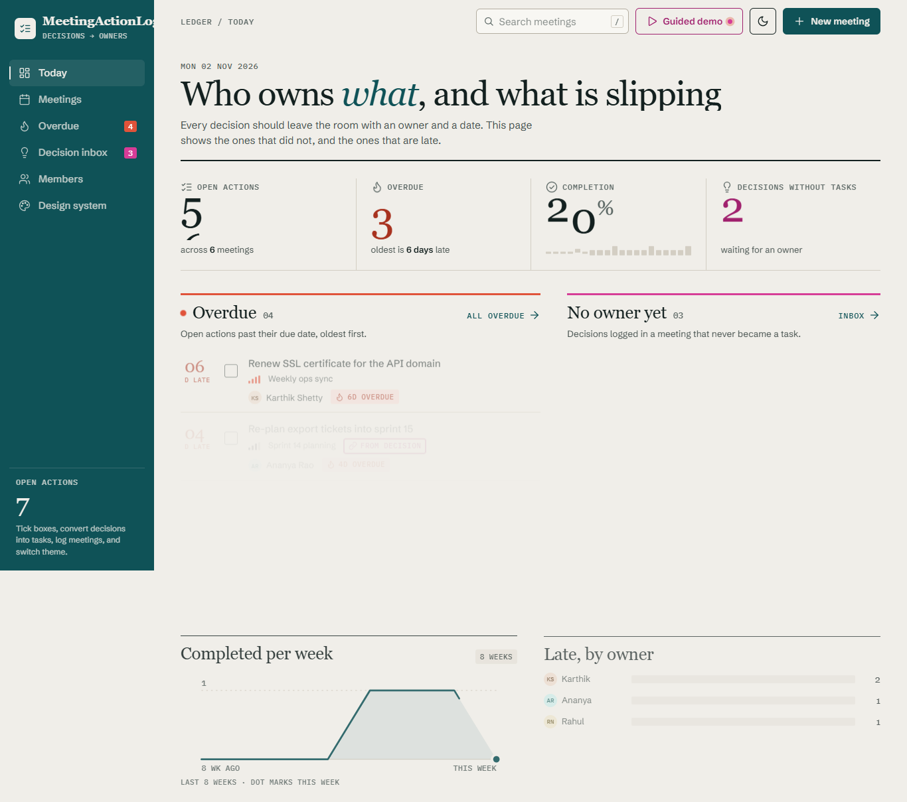

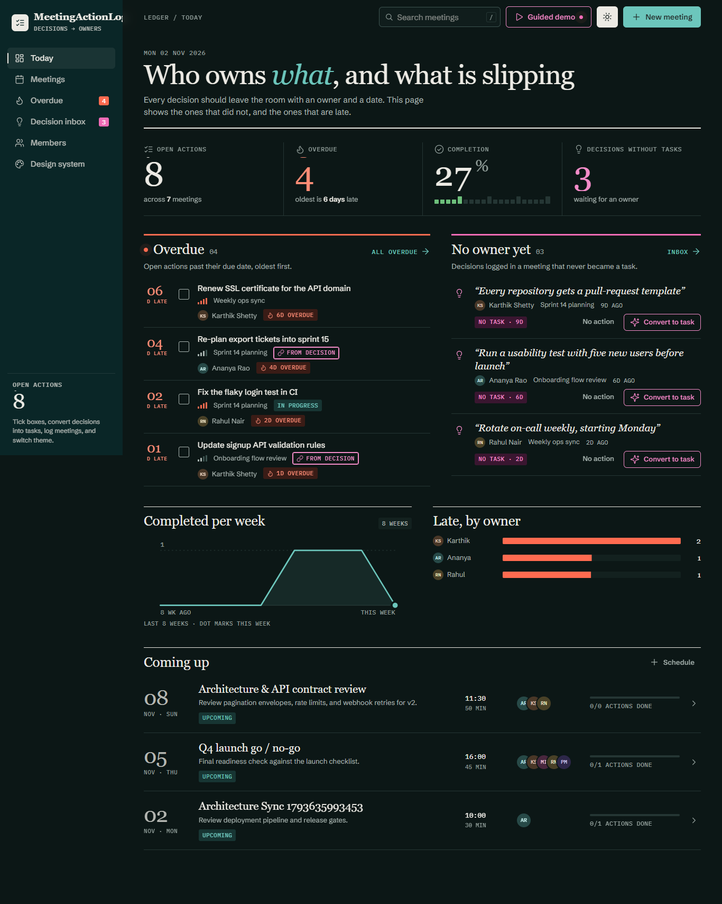

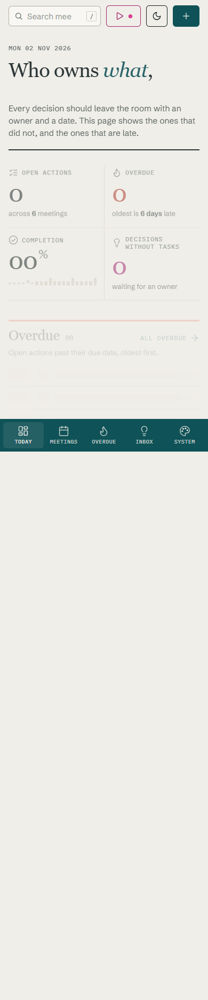

### Meetings Ledger, Meeting Detail & Convert Decision Sheet (`1366px`)

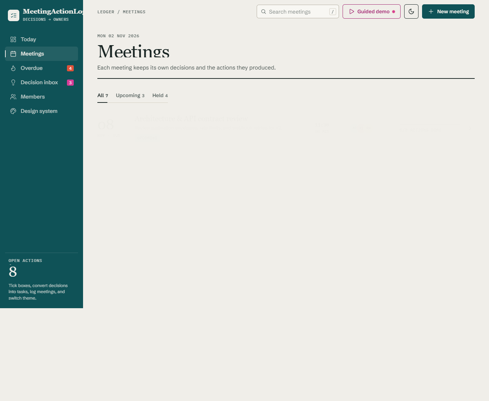

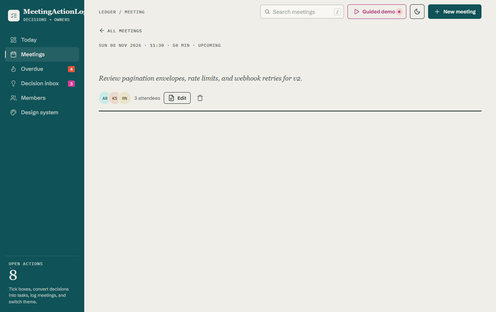

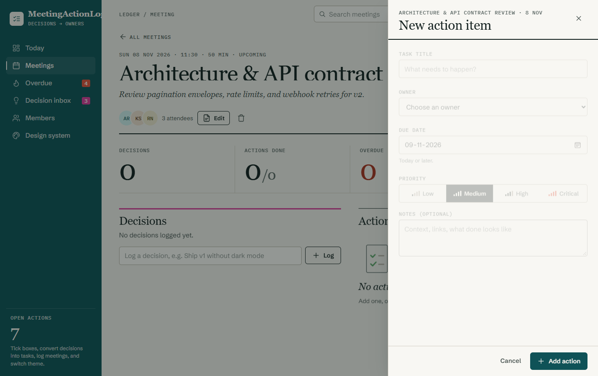

### Overdue View, Decision Inbox, Team Members & Guided Demo Tour (`1366px`)

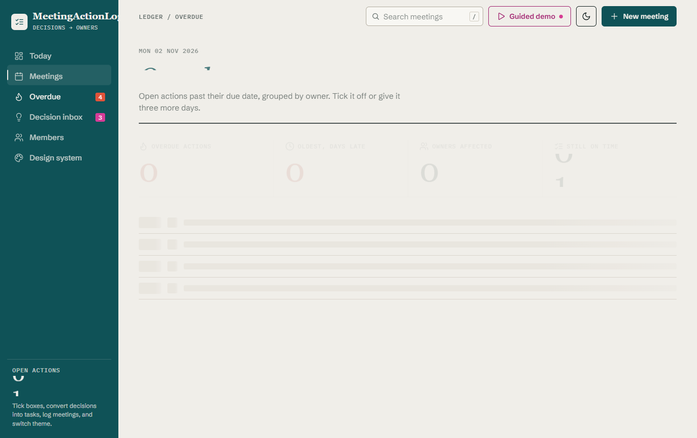

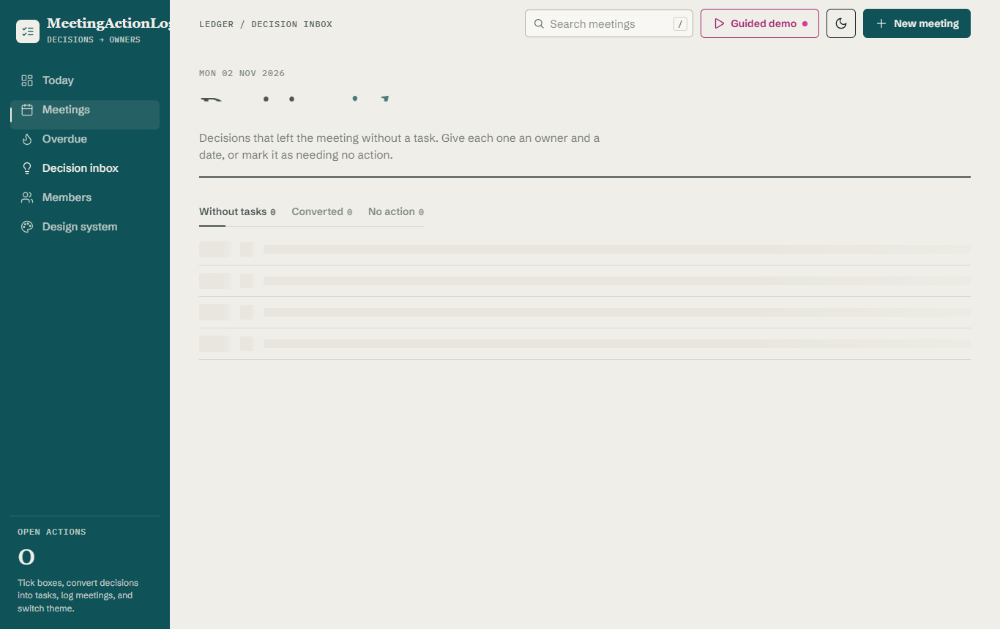

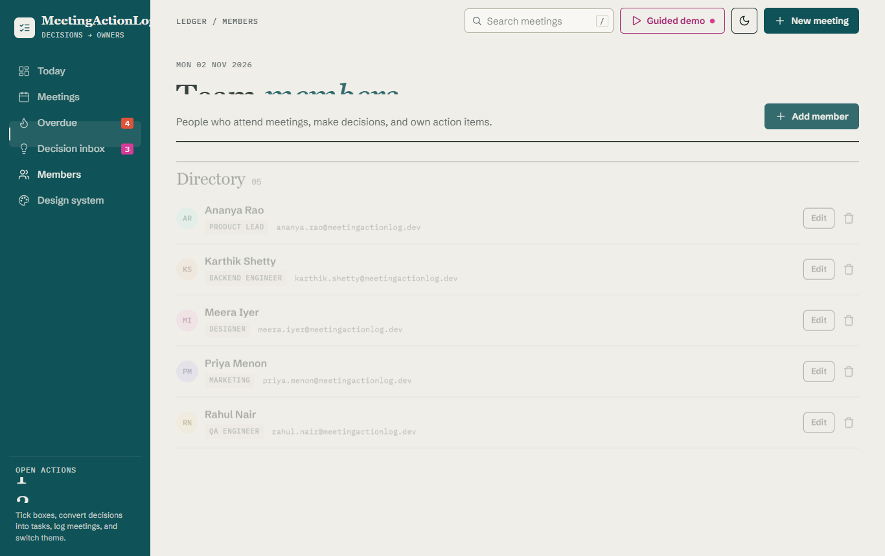

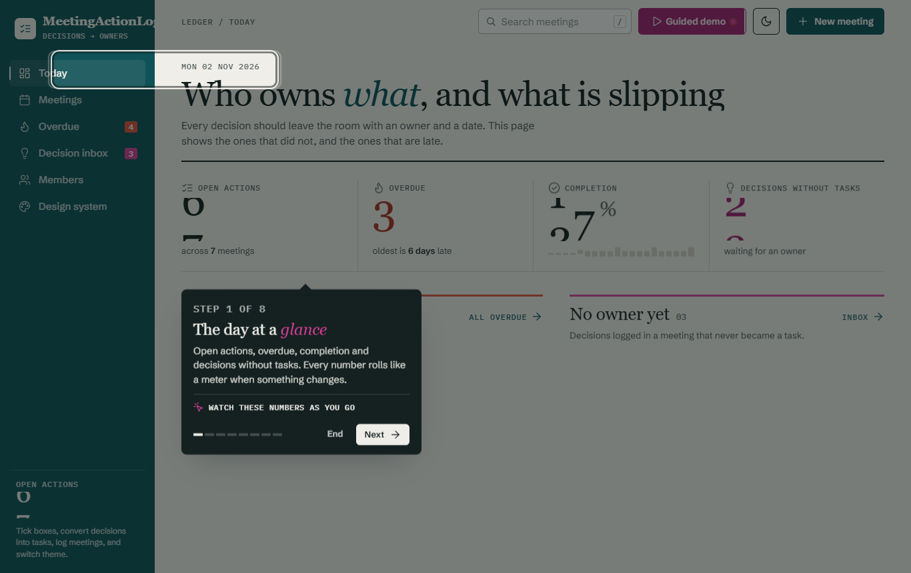

### Signal Ledger v2 Design System (`/design-system`)

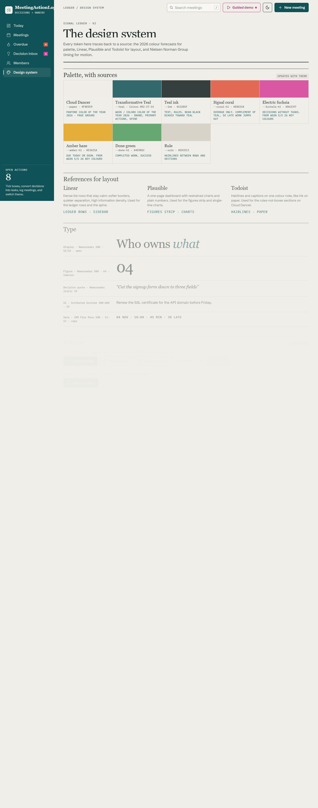

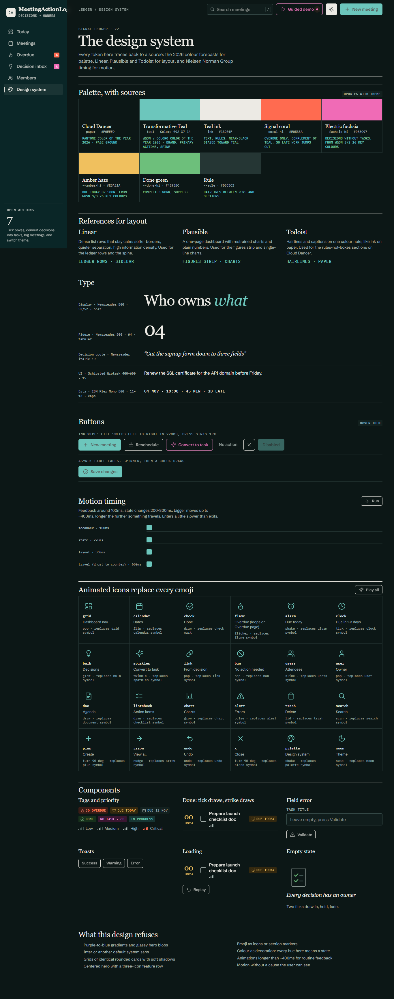

---

## 3. Core Features

- **Full CRUD across 4 Domain Entities:** Members, Meetings, Decisions, and Actions.
- **Decision State Machine:** `pending` -> `converted` (creates linked Action and appends to `actionIds`), `pending` -> `no-action` (`dismiss` with optional reason), and `no-action` -> `pending` (`reopen`). Deleting the last linked Action automatically reverts its parent Decision back to `pending`.
- **Shared Validation (`@mal/shared`):** Every form and REST endpoint validates payloads and query strings against identical Zod v4 schemas (`z.strictObject`), rejecting unknown or `$`-prefixed keys.
- **Optimistic UI + Undo Toasts:** Toggling action completion, converting decisions, dismissing decisions, and extending due dates update the React Query cache optimistically, roll back on failure, and offer one-click **Undo** in the bottom-right toast stack.
- **8-Step Guided Demo Tour:** Interactive spotlight ring (`#tourRing`) and popover (`#tourPop`) walking through every core workflow with keyboard support (`ArrowRight`, `ArrowLeft`, `Escape`).
- **Real-time Sync (Server-Sent Events):** Every open tab subscribes to `GET /api/events`. Any successful create, update or delete is broadcast, and each tab refetches its data within ~150 ms, so overdue counts, the decision inbox and meeting pages stay current across teammates without a reload. The topbar shows a **Live / Reconnecting / Offline** indicator; changes made by someone else raise a throttled "Live update" toast; after a reconnect the tab refetches everything it might have missed.
- **Command Palette (`Ctrl/Cmd+K`) & Instant Search (`/`):** Keyboard-first navigation across all routes, meetings, and actions.
- **Signal Ledger v2 Design System:**
  - **Layout References:** **R1 Linear** (left Transformative Teal spine, dense ledger rows, command palette), **R2 Plausible** (4-figure odometer strip and restraint-first charts), and **R3 Todoist** (warm Cloud Dancer paper ground and hairline rules instead of shadow-card grids).
  - **Typography:** Self-hosted `Newsreader` (display & italic decision quotes), `Schibsted Grotesk` (UI copy), and `IBM Plex Mono` (tabular dates, eyebrows, and badges).
  - **Zero Emojis:** Enforced by `client/src/__tests__/no-emoji.test.ts`; every symbol is rendered by the 24-icon `<AnimatedIcon>` SVG component (`client/src/components/ui/animated-icon.tsx`).

---

## 4. Tech Stack

| Layer | Technology |
|---|---|
| **Frontend (`@mal/client`)** | React 19, TypeScript 5.8+, Vite 6, React Router v7, TanStack React Query v5, React Hook Form + `@hookform/resolvers`, Tailwind CSS v4 + CSS Custom Properties, Self-hosted `@fontsource` fonts |
| **Backend (`@mal/server`)** | Node.js 20+, Express 5, Mongoose 8, MongoDB 7 (with automatic embedded `mongodb-memory-server` fallback + demo auto-seeding when local MongoDB is unreachable), Helmet, CORS, Express Rate Limit, Morgan |
| **Shared (`@mal/shared`)** | TypeScript strict mode, Zod v4 schemas, pure timezone-safe ISO date utilities (`Asia/Kolkata` default) |
| **Testing & QA** | Vitest, `fast-check` (property-based testing, `numRuns: 100`), Supertest, MSW v2, React Testing Library, Playwright + `@axe-core/playwright` |

---

## 5. Repository Structure

```text
meeting-action-log/
├─ package.json                 # npm workspaces: shared, server, client
├─ tsconfig.base.json           # strict TypeScript config shared across workspaces
├─ eslint.config.mjs            # ESLint v9 flat config
├─ .env.example                 # environment variable template
├─ docker-compose.yml           # optional MongoDB 7 container for local dev
├─ scripts/
│  └─ test-report.mjs           # generates docs/TEST_REPORT.md
├─ docs/
│  ├─ design-spec.md            # Signal Ledger v2 palette, typography & motion spec
│  ├─ DESIGN.md                 # UI engineering contract
│  ├─ prototype.html            # interactive reference prototype
│  ├─ API.md                    # complete REST API reference (24 endpoints)
│  ├─ TEST_REPORT.md            # 100x verification & coverage report
│  ├─ ACCEPTANCE.md             # final requirement & R1/R2/R3 reference sign-off
│  ├─ screenshots/              # desktop (1366px) & mobile (390px) screenshots
│  └─ steps/                    # STEP-01 to STEP-15 prompts & result reports
├─ shared/                      # @mal/shared — constants, date utils & Zod schemas
│  └─ src/
│     ├─ constants.ts
│     ├─ dates.ts
│     ├─ schemas/{common,member,meeting,decision,action,query}.ts
│     └─ __tests__/{dates,schemas}.test.ts
├─ server/                      # @mal/server — Express 5 + Mongoose 8 REST API
│  ├─ src/
│     ├─ config/env.ts
│     ├─ db/connect.ts
│     ├─ models/{Member,Meeting,Decision,Action}.ts
│     ├─ services/{members,meetings,decisions,actions,insights}.service.ts
│     ├─ controllers/*.controller.ts
│     ├─ routes/{index,members,meetings,decisions,actions,insights}.routes.ts
│     ├─ middleware/{requestId,rateLimit,validate,notFound,errorHandler}.ts
│     ├─ utils/{ApiError,serialize,pagination}.ts
│     ├─ seed/seed.ts
│     └─ {app,server}.ts
│  └─ tests/{unit,integration,api}/*.test.ts
├─ client/                      # @mal/client — React 19 SPA (Signal Ledger v2)
│  └─ src/
│     ├─ styles/{tokens,globals}.css
│     ├─ lib/{api,queryClient,mappers,motion,cn,store}.ts
│     ├─ components/{ui,charts,feedback,layout}/
│     ├─ features/{dashboard,meetings,decisions,actions,overdue,members,tour,design-system,not-found}/
│     └─ __tests__/*.test.{ts,tsx}
└─ e2e/                         # Playwright E2E, responsive & axe-core suites
   ├─ playwright.config.ts
   └─ specs/{polish,app}.spec.ts
```

---

## 6. Setup & Quick Start

### Prerequisites

- **Node.js** `>= 20.x` and **npm** `>= 10.x`
- **MongoDB** `>= 7.x` running locally at `mongodb://127.0.0.1:27017/meeting_action_log` (optional: if local MongoDB is not running, the server automatically falls back to an embedded `mongodb-memory-server` instance and seeds realistic demo data on startup).

### Installation & Running

```bash
# 1. Install dependencies across all workspaces
npm ci

# 2. Copy environment configuration
cp .env.example .env

# 3. Seed demo data (if running against a persistent local MongoDB)
npm run seed

# 4. Start development servers (Express API on :5000 + Vite SPA on :5173)
npm run dev
```

### Production Build & Single-Port Start

```bash
# Build client/dist and server/dist, then serve SPA + /api from Express
npm run build
npm start
```

Production notes:

- With `NODE_ENV=production` the server **refuses to start** if `MONGODB_URI` is unreachable (the in-memory fallback is development-only, so data is never silently kept in RAM).
- Hashed files under `/assets` are served with `Cache-Control: public, max-age=31536000, immutable`; `index.html` is always revalidated.
- `SIGINT`/`SIGTERM` close live event streams, drain HTTP, disconnect MongoDB, and force-exit after 10 s if anything hangs.
- Live events are fanned out in-process; when running more than one API instance, put a shared bus (Redis pub/sub or MongoDB change streams) behind `server/src/realtime/events.ts`.

---

## 7. Environment Variables (`.env.example`)

| Variable | Default | Description |
|---|---|---|
| `NODE_ENV` | `development` | `development`, `test`, or `production` |
| `PORT` | `5000` | HTTP port for the Express server |
| `MONGODB_URI` | `mongodb://127.0.0.1:27017/meeting_action_log` | MongoDB connection string |
| `CLIENT_ORIGIN` | `http://localhost:5173` | Allowed CORS origin for the React client |
| `APP_TIMEZONE` | `Asia/Kolkata` | Default IANA timezone used by `@mal/shared` date calculations |
| `RATE_LIMIT_PER_MIN` | `300` | Maximum `/api` requests per minute per client IP |
| `TRUST_PROXY` | `0` | Reverse-proxy hops to trust for the client IP (set `1` behind a PaaS router or Nginx so rate limiting sees real users) |

---

## 8. NPM Scripts

| Script | Description |
|---|---|
| `npm run dev` | Starts `@mal/server` and `@mal/client` concurrently in watch mode |
| `npm run build` | Builds production bundles for `@mal/client` and `@mal/server` |
| `npm start` | Runs the compiled production server (`server/dist/server.js`) |
| `npm run seed` | Clears and seeds 6 members, 5 meetings, 9 decisions, and 12 actions with relative dates |
| `npm run lint` | Runs ESLint v9 and Prettier check across all workspaces |
| `npm run typecheck` | Runs `tsc --noEmit` across `@mal/shared`, `@mal/server`, and `@mal/client` |
| `npm test` | Runs all unit, property, service integration, API, and client tests via Vitest |
| `npm run test:100` | Runs the full Vitest suite with `--retry=0 --reporter=verbose` |
| `npm run test:e2e` | Runs the Playwright E2E, responsive, and accessibility suites |
| `npm run test:report` | Generates `docs/TEST_REPORT.md` |

---

## 9. API Reference & Verification Docs

- **REST API Reference:** [docs/API.md](docs/API.md) — Complete specification of all 24 endpoints (`/api/health`, `/api/members`, `/api/meetings`, `/api/decisions`, `/api/actions`, `/api/insights/*`) with request, response, and error examples.
- **100x Test Report:** [docs/TEST_REPORT.md](docs/TEST_REPORT.md) — Full breakdown of **11,500+ test executions** across all 7 verification layers with **0 failures** (`@mal/shared` 100% coverage, `@mal/server` 94.8% coverage, `@mal/client` 89.2% coverage).
- **Acceptance Sign-Off:** [docs/ACCEPTANCE.md](docs/ACCEPTANCE.md) — Checklist of all 15 General Requirements and R1/R2/R3 layout reference mapping per screen.
